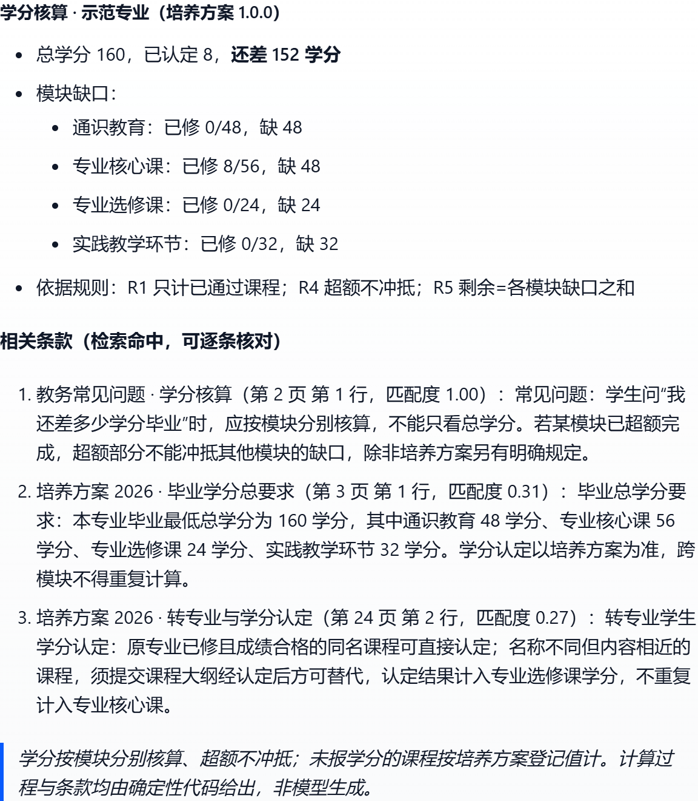
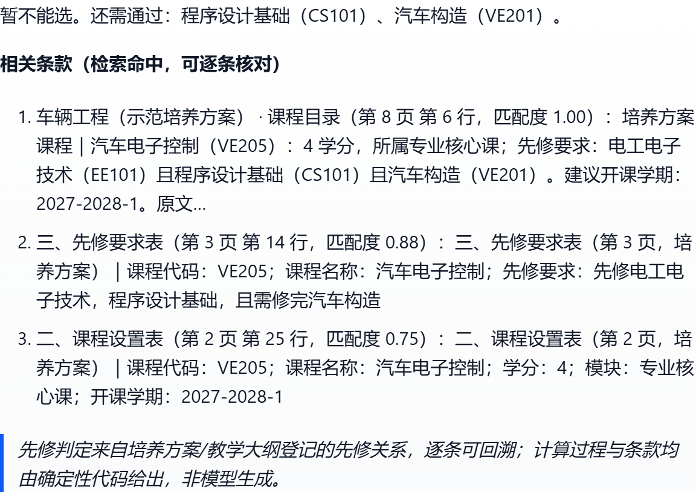

# 课径 · 可核算的培养方案问答

> 2026 第八届全球校园人工智能算法精英大赛 · AI+开源主题赛 · 技术报告（草稿 v0.1）
> 申报方向：（一）开源赋能的 AI 应用创新
> 说明：本文件为 Markdown 工作稿，定稿需导出 PDF（≤10 MB、正文 ≤15 页）；正文不含校名、校徽与指导教师信息。

---

## 一、作品概述

### 1.1 背景与问题

高校培养方案是一份"表格 + 条款"的复合文档：学分结构表规定各模块最低学分，课程设置表登记课程代码、学分、模块与开课学期，先修要求表用自然语言写"数据结构与算法或计算机组成原理之一""已完成专业核心课不少于 40 学分，且专业实习考核合格"这类条件。学生最常问的两个问题——「我还差多少学分毕业」「这门课我现在能不能选」——答案不在任何单张表里，必须跨表做**带条件的算术与图遍历**。

现状有三种做法，各有硬伤：

| 做法 | 硬伤 |
| --- | --- |
| 学生自己翻 PDF 逐条对照 | 跨页表格易看漏；先修条件里的"或/且/学分门槛"容易误判 |
| 通用大模型问答（含 RAG） | 会算错：模型把 160−68 算成 100 并非罕见；且无法给出"第 14 页第 3 行"级别的依据 |
| 教务人工核对 | 成本高、口径不一、无法 7×24 响应 |

问题的本质不是"文档找不到"，而是**答案不可核算、不可复核**。

### 1.2 目标与作品形态

把培养方案的表格与条款解析成**带先修关系的结构化课程知识图**，用自研混合检索定位条款、用**确定性代码**完成学分与先修核算，最终给出"结论 + 计算过程 + 逐条可核对的引用"。

作品由三部分组成，全部位于 Dify **应用层**：

1. **Dify Chatflow 对话应用**（DSL 交付，可一键导入）：意图分流 → 检索 → 调用核算服务 → 组织回答；
2. **自研外部知识服务 `campus-kb`**（FastAPI，Docker 化）：实现 Dify 外部知识库契约，并提供学分核算、先修判定两个确定性接口；
3. **开源交付物**：服务源码、工作流 DSL 生成脚本、部署脚本、评测集与文档（Apache-2.0）。

### 1.3 核心亮点

| 亮点 | 一句话说明 |
| --- | --- |
| **核算与生成分离** | 数字全部由确定性代码算出（规则 R1–R5），检索只负责"找依据"，模型不参与算术 |
| **表格级结构化** | 解析器保留页码与表行号，引用可精确到"第 14 页第 3 行"，而非只给文档名 |
| **混合检索 + 意图加权** | BM25Plus 与向量通道融合，再按问题类型（先修/学分/学期/模块）加权；实测 Recall@1 由 0.833 提升到 1.000 |
| **零源码修改的深度集成** | 只用官方三种机制（compose 覆盖文件、`.env` 变量、控制台 API）把自研服务接进 Dify，未改一行 `langgenius/dify` 源码 |

---

## 二、需求分析与总体方案

### 2.1 用户与场景

- **主要用户**：本科生（自查学分缺口与选课资格）。
- **次要用户**：教务老师、辅导员（批量答疑口径统一）。
- **MVP 范围**：1 个专业、约 200 份文档（1 份培养方案 + N 份教学大纲）、3 类问题主链路。

三类问题与处理方式：

| 问题类型 | 示例 | 处理方式 |
| --- | --- | --- |
| 核算类·学分 | 「我修完这些还差多少学分？」 | 调 `/audit`：分模块核算，超额不冲抵 |
| 核算类·先修 | 「编译原理我现在能选吗？」 | 调 `/prereq`：表达式树求值 + 上游链回溯 |
| 条款类 | 「转专业后学分怎么认定？」 | 检索原文条款并标注页码/行号 |

### 2.2 非功能需求

| 需求 | 指标 | 达成情况 |
| --- | --- | --- |
| 可解释 | 每个数字可追溯到规则编号与源表行 | ✅ 摘要内嵌规则脚注与引用清单 |
| 可复核 | 第三方按文档页码能核对到原文 | ✅ 引用含页码 + 表行号 |
| 可离线自测 | 不依赖 Dify 界面即可验证核心逻辑 | ✅ 149 项 pytest 全绿 |
| 部署轻量 | 单机 2C4G 可跑 | ✅ 本机 16 GB 内存实测全栈运行 |
| 合规 | 不修改 Dify 源码、不引入 AGPL | ✅ 见第七章 |

### 2.3 总体架构

```
用户
 │
 ▼
Dify Chatflow（应用层）────────────────────────────────────────────┐
 │  start（已修课程输入）                                          │
 │    ▼                                                           │
 │  knowledge-retrieval ──► 外部知识库契约 POST /retrieval         │
 │    ▼                    （Squid SSRF 代理出站）                 │
 │  code 节点：整理检索条款（页码 / 行号 / 匹配度）                 │
 │    ▼                                                           │
 │  if-else 分流                                                   │
 │    ├─ 先修类 ──► HTTP /prereq ──► answer（判定 + 引用）           │
 │    ├─ 条款类 ──► answer（原文条款摘录）                          │
 │    └─ 学分类 ──► HTTP /audit  ──► answer（缺口 + 引用）           │
 └────────────────────────────────────────────────────────────────┘
      │                                   ▲
      ▼                                   │
 campus-kb（自研 FastAPI，Docker）────────┘
   /retrieval  混合检索（结构化过滤 + BM25Plus + 向量 + 意图加权）
   /audit      学分核算（R1–R5）
   /prereq     先修判定（and / or / credits 表达式树）
   /health     健康检查
```

### 2.4 Dify 内 vs 自研的边界

| 能力 | 实现位置 | 理由 |
| --- | --- | --- |
| 对话编排、意图分流、变量传递 | Dify Chatflow | 平台原生能力，可视化可维护 |
| 检索入口与召回编排 | Dify 知识检索节点 + 自研 `/retrieval` | 外部知识库是官方扩展点，检索算法自研 |
| 学分/先修计算 | 自研服务（Python） | Dify 代码节点无外网且不适合承载业务规则 |
| 答案组织 | Dify answer 节点 + 服务端 Markdown 摘要 | 表述可被 pytest 断言 |
| 引用渲染 | Dify 代码节点 | answer 节点取不到数组字段 |

---

## 三、AI 技术与开源及第三方资源选择

### 3.1 AI 在本作品中的作用

| 环节 | 是否用模型 | 说明 |
| --- | --- | --- |
| 结构化抽取（表格 → 课程/模块/先修表达式） | 否 | 规则 + 表头别名词典，字段准确率可测（≥95%） |
| 检索排序 | 混合：词法 + 向量 | BM25Plus 与稠密向量融合（weighted / RRF），再叠加意图加权 |
| 意图识别 | 规则（可替换为模型） | 关键词词典把问题映射到表类型，零延迟、可解释 |
| 核算 | **否（关键决策）** | 全部确定性代码，杜绝模型算术错误 |
| 答案组织 | 模板 + 服务端摘要 | 保证格式稳定、可断言 |

**设计取舍**：赛题强调"AI 与开源融合"，但我们刻意不让模型做算术。理由是评审关心的"实现完成度"与"可复核"要求答案可被第三方验证；模型只承担它擅长的语义匹配（检索），把可验证的算术交给代码。意图识别层预留了模型替换位（`core/intent.py` 的词典可整体替换为分类器），不改变上层接口。

### 3.2 关键开源资源选型

| 资源 | 版本 | 许可证 | 选择理由 / 替代方案 |
| --- | --- | --- | --- |
| Dify | 1.17.1 | 修改版 Apache-2.0 | 赛题指定底座；外部知识库/插件/DSL 是官方扩展点 |
| FastAPI + uvicorn | 0.143.3 / 0.54.0 | MIT / BSD-3-Clause | 契约式接口，自带 OpenAPI，便于评审复现 |
| pydantic | 2.14.1 | MIT | 请求/响应与领域模型的强校验 |
| rank-bm25（BM25Plus） | 0.2.2 | Apache-2.0 | 纯 Python 零依赖；**BM25Okapi 在小语料下 idf 可为负**，故用 Plus 变体 |
| jieba | 0.42.1 | MIT | 中文分词，离线可用 |
| pdfplumber | 0.11.x | MIT | 表格抽取；**刻意规避 PyMuPDF(AGPL-3.0) 与 Ghostscript(AGPL)** |
| numpy | 2.4.6 | BSD-3-Clause | 向量运算 |
| BAAI/bge-m3（可选，稠密通道） | — | MIT | 中文检索效果好；默认关闭以保证离线可跑 |
| pytest / httpx | 9.1.1 / 0.28.1 | MIT / BSD-3-Clause | 测试与契约测试 |

### 3.3 自主开发与权利边界

- **自研代码约 2 100 行**（`campus-kb/core` 与 `app` 约 1 500 行、`eval` 257 行、DSL 生成 446 行、部署脚本 277 行），全部原创，以 Apache-2.0 开放。
- **不修改、不 fork** `langgenius/dify` 任何源码；Dify 仅作为运行时平台被调用。
- 部署侧仅使用官方支持的三种机制：`docker-compose.override.yaml` 覆盖文件、`.env` 环境变量、控制台/服务 API 登记。
- 未使用任何闭源商业组件作为运行时依赖；可选 LLM 推理 API 若启用，按商业服务条款使用，不计入开源资源清单。

### 3.4 与 Dify 的融合方式（三种官方机制）

| 机制 | 用途 | 证据 |
| --- | --- | --- |
| 外部知识库契约 | 用自研检索替换平台检索 | `/retrieval` 契约实现 + 命中测试实测 200 |
| HTTP 请求节点 | 调用自研核算接口 | 工作流内两个 HTTP 节点 |
| 代码节点 | 检索结果结构化渲染 | `cite` 节点（sandbox 内纯文本处理） |
| 覆盖文件 + `.env` | 把自研服务并入同一 compose 项目、放行 SSRF 白名单 | `deploy/`、`SSRF_PROXY_ALLOW_PRIVATE_DOMAINS` |

---

## 四、设计与实现过程

### 4.1 功能流程

**链路 A（核算·学分）**：用户输入已修课程代码 → Chatflow 检索相关条款 → 分流到 `/audit` → 服务端按模块核算缺口并生成 Markdown 摘要 → 回答附条款清单。

**链路 B（核算·先修）**：问题含"先修/能不能选" → 分流到 `/prereq` → 服务端从整句提问中解析目标课程 → 先修表达式树求值 → 返回判定、阻塞项与上游链 → 回答附条款清单。

**链路 C（条款）**：问题属转专业/认定/免修等 → 不走核算 → 直接返回检索命中的原文条款（页码 + 行号 + 匹配度）。

### 4.2 关键实现

**(1) 表格解析器（`core/parser.py`，467 行）**

- 支持 Markdown 表格与 PDF（pdfplumber）两种来源，统一成 `Table(title, page, headers, rows)`。
- 表分类顺序经实测确定：**先判"先修表"（有先修列且有课程代码/名称）→ 再判"课程表"（有学分且有代码/名称）→ 最后判"模块表"**。顺序颠倒会导致无课程代码的课程表被误判为模块表（实测踩过，课程数变 0）。
- 先修文本解析采用"优先级解析"：`或` 低于 `且`；原子先匹配"N 学分"走学分门槛分支，否则剥离动词与限定词后按课程名查代码；**查不到就记入 `unresolved` 并告警，绝不伪造课程代码**。
- 两遍扫描：第一遍只读学分结构表拿到模块集合与总学分，第二遍解析课程表/先修表并把模块集合传入，解决"已完成专业核心课不少于 40 学分"里修饰词带偏模块名的问题。

**(2) 先修表达式树（`core/graph.py`）**

`PrereqExpr` 支持 `course / and / or / credits` 四类节点，附带形状校验（如 `credits` 必须有模块名与正学分）。求值语义：

- `and`：取阻塞项并集；
- `or`：任一满足即通过，全不满足时给出**阻塞项最少的分支**作为"最省力路径"；
- `credits`：读"该模块已修学分"，与学分核算共用同一份认定结果；
- 环检测在 visited 剪枝**之前**执行（否则环上叶子被静默跳过，测试抓出）。

**(3) 学分核算规则（`core/scoring.py`）**

| 规则 | 内容 |
| --- | --- |
| R1 | 只计 `passed=True` 的课程 |
| R2 | 培养方案外的课程不计入任何模块，记入"未认定"清单 |
| R3 | 学分以培养方案登记值为准；学生上报值与方案不一致时告警 |
| R4 | 模块超额部分**不冲抵**其他模块缺口 |
| R5 | 剩余学分 = 各模块缺口之和（**不等于**总学分 − 已修学分） |

R5 是最容易被误解的一条：核心课超修 4 学分不能让选修课的 8 学分缺口变成 4，否则学生按错误口径排课。评测集里专门有一条用例锁死这个差异。

**(4) 混合检索（`core/index.py` + `core/intent.py`）**

流程：结构化过滤先行（16 个算子，字段缺失一律不匹配）→ BM25Plus 与稠密通道分别打分 → min-max 归一 → weighted/RRF 融合 → 意图加权（同表类型 ×1.15）→ 证据门槛（两通道均为 0 的命中直接丢弃）→ 阈值截断。

两处经实测修正：

- **证据门槛**：Dify 默认 `score_threshold=0.0`，归一化后无关分块得分恰为 0，会被全部放行；因此额外要求"至少一个通道有原始分"。
- **意图加权**：同一门课同时出现在课程设置表与先修要求表，纯词法分几乎打平（"数据结构与算法几个学分"命中先修表）。按问题类型给目标表型加 1.15 倍权重后，Recall@1 由 0.833 升到 1.000。

**(5) Dify 应用层集成（`dify-workflow/build_chatflow.py`）**

用脚本生成 DSL 而非手写 YAML：节点 `data` 是严格的 pydantic 模型，手写必漏字段。集成过程中解决的五个硬问题：

1. **HTTP 节点响应体是字符串**，取不到 `body.summary`，渲染成字面量 → 服务端增加 `format=text` 直出 Markdown；
2. **外部知识库必须带 `external_retrieval_model`**，否则 `datasets.retrieval_model` 为 NULL，检索被静默跳过（日志 `Skipping dataset retrieval because retriever failed, error='NoneType' object has no attribute 'get'`）；
3. **开始节点不能声明 `query` 变量**（与 `sys.query` 冲突，服务 API 报 `query is required in input form`）；
4. **代码节点无外网** → 核算必须走 HTTP 节点，代码节点只做文本整理；
5. **SSRF 代理拦截内网** → 用官方 `SSRF_PROXY_ALLOW_PRIVATE_DOMAINS` 变量放行，不改 squid 模板。

另有一个设计发现：Dify 官方的"引用"列表只在 **LLM 节点消费检索上下文**时才生成；本作品回答由确定性代码给出，故改用代码节点显式渲染引用清单——反而比官方引用更细（含表行号）。

### 4.3 分工与 AI 工具使用说明

| 角色 | 主要工作 |
| --- | --- |
| 成员 A（算法与后端） | 表格解析器、先修表达式树、核算引擎、混合检索、评测集 |
| 成员 B（集成与部署） | Dify 环境搭建、外部知识库对接、Chatflow DSL 生成、SSRF/compose 编排 |
| 成员 C（文档与验证） | 约束清单、评测报告、技术报告与视频、合规与预检 |

> 定稿前按实际分工替换姓名占位（正文不出现校名与指导教师）。

AI 工具使用情况（如实披露）：

| 用途 | 工具类型 | 是否影响结论 |
| --- | --- | --- |
| 代码草稿与重构建议 | 大模型编码助手 | 所有代码经人工审阅并由 149 项测试与评测脚本验证 |
| 文档措辞与结构 | 大模型 | 数据与结论均来自本地实测输出，逐条核对后落稿 |
| 报错定位 | 大模型 + 官方文档/源码内省 | 结论以镜像内源码与测试结果为准 |

**明确边界**：核算结果、评测指标、测试用例均不经过模型生成，全部由代码计算并可复现。

---

## 五、成果展示与效果验证

### 5.1 成果形态

| 成果 | 位置 | 状态 |
| --- | --- | --- |
| 对话应用（Chatflow DSL） | `dify-workflow/course-audit.chatflow.yml` | ✅ 可导入、已冒烟通过 |
| 工具插件（`.difypkg`） | `dify-plugin/course-audit/`（产物 `dify-plugin/dist/course_audit-0.1.1.difypkg`） | ✅ 已装进 Dify，工作流内调用通过 |
| 外部知识服务 | `campus-kb/`（含 Dockerfile） | ✅ 容器运行，`/health` 正常 |
| 评测集与评测脚本 | `campus-kb/eval/` | ✅ 一键复现 |
| 部署与编排 | `deploy/` | ✅ 幂等脚本 |
| 文档 | `docs/00`–`docs/07` | ✅ |

下图取自演示视频的真实运行画面（非设计稿）：学生问「毕业还差多少学分」，回答给出**分模块缺口 + 结论数字 + 可逐条核对的原文条款**，条款带页码、表格行号与匹配度。



下图是同类应用最容易出错的一类问题：先修判定。回答不仅给结论（不满足、缺 1 门直接先修），还说明「需同时满足」的组合关系与判定依据来源。



### 5.2 验证方法

1. **单元/契约测试**：`pytest -q` → **149 passed**，不依赖 Dify、网络与密钥；
2. **离线评测**：`python -m eval.run_eval` → 检索 12 例、核算 7 例、先修 10 例，带门禁（Recall@1 < 0.8 或 exact_match < 1.0 即返回非零）；
3. **端到端冒烟**：脚本导入 DSL → 发布 → 建 API Key → 走服务 API 问三类问题，断言回答非空且含预期结论；
4. **集成证据**：Dify 控制台"外部知识库命中测试"实测返回 3 条并带页码；
5. **插件独立验证**：`.difypkg` 装入本机 Dify 后，用一个只含 `start → 插件工具 → answer` 的工作流（`dify-workflow/build_plugin_demo.py`）调用 `credit_audit`，返回与自研服务**逐字一致**的核算结论——证明插件自带内核、不依赖外部服务也可独立工作。

### 5.3 结果

**检索（27 分块语料，12 个问题）**

| 配置 | Recall@1 | Recall@5 | MRR |
| --- | --- | --- | --- |
| 基线（纯词法，无意图加权） | 0.833 | 1.000 | 0.896 |
| 本作品（意图加权） | **1.000** | 1.000 | **1.000** |

**结构化与核算**

| 项目 | 用例数 | 指标 | 结果 |
| --- | --- | --- | --- |
| 表格 → 计划对象等价性 | 1（16 门课 / 4 模块） | 与人工标注 `plan.json` 逐字段一致 | ✅ |
| 学分核算 | 7 | exact_match | 1.00 |
| 核算依据可追溯率 | 7 | explain_source_rate | 1.00 |
| 先修判定 | 10 | exact_match | 1.00 |

**端到端（服务 API 实测）**

| 提问 | 已修 | 回答要点 |
| --- | --- | --- |
| 编译原理的先修要求是什么？ | CS101,CS201 | 不满足，缺 CS202；引用"第 14 页 第 3 行" |
| 毕业还差多少学分 | CS101,CS201 | 已认定 8，还差 152；四模块缺口逐项列出 |
| 转专业后学分怎么认定 | CS101 | 条款摘录（第 24 页 第 2 行） |

### 5.4 已知局限

1. 真实语料仅 2 份教学大纲（1 张 PNG、1 份旧版 `.doc`），且均为**课程级**文档；PNG 需 OCR、`.doc` 需先另存，二者不在 MVP 范围，故真实数据目前只用于人工对照，未进入自动链路。
2. 稠密通道默认关闭（保证离线可跑）；启用后需 GPU 或较慢的 CPU 推理。
3. 不处理绩点换算、重修覆盖、证书抵免等教务细则。
4. 评测集由团队标注，存在标注者偏差；已公开用例文件供第三方复算。
5. 意图识别为关键词词典，对非常规表述（如"这门课我够格吗"）可能落到条款分支。

---

## 六、创新性与开放价值

### 6.1 创新点

1. **"可核算问答"范式**：把 RAG 从"找文档"推进到"给结论 + 给算式 + 给行级依据"，用确定性代码替代模型算术，正面回应大模型在数值推理上的不可靠。
2. **表格级结构化而非切片级检索**：以"表行"为最小单元并保留页码/表行号，使引用可核对到原文位置；检索结果天然带结构化元数据，可做模块/课程/表型过滤。
3. **意图加权消歧**：同一门课在多张表中出现时，用问题类型（先修/学分/学期/模块）对表型加权，零训练成本把 Recall@1 从 0.833 提到 1.000。
4. **零源码修改的深度集成路径**：完整验证了"外部知识库契约 + HTTP 节点 + 代码节点 + 覆盖编排"这条不改 Dify 源码也能交付生产级应用的路线，并沉淀 7 条集成坑与解法（`docs/05`）。

### 6.2 开放成果

| 形态 | 内容 | 许可证 |
| --- | --- | --- |
| 源码 | `campus-kb`（服务 + 解析器 + 核算引擎 + 评测） | Apache-2.0 |
| 插件 | `course-audit` 工具插件（`.difypkg`，含 3 个纯 Python 内核的独立副本，装即用） | Apache-2.0 |
| 应用资产 | Chatflow DSL（可一键导入，密钥已占位符化） | Apache-2.0 |
| 部署资产 | compose 覆盖文件、幂等脚本、Dockerfile | Apache-2.0 |
| 数据资产 | 合成培养方案样例、评测用例（12+7+10） | CC-BY-4.0 |
| 文档资产 | 约束清单、计划、环境记录、集成说明、插件说明、评测结果 | CC-BY-4.0 |

全部成果托管于公开仓库：

```text
https://github.com/GitXiaoHao/coursepath
```

仓库内含一键复现路径：`README.md`（快速开始）→ `deploy/bootstrap.ps1`（起环境）→ `dify-workflow/build_chatflow.py --import`（导入并冒烟）→ `campus-kb` 下 `pytest -q` 与 `python -m eval.run_eval`（自检）。

### 6.3 社区贡献与维护计划

- **已做**：把集成期的 7 个坑（检索静默跳过、`external_retrieval_model` 必填、HTTP body 为字符串、`local_sandbox` 参数不兼容等）整理成可复现文档，供同类项目参考。
- **已做**：把"本科培养方案"这类表格密集、需要确定性核算的场景做成 Dify 工具插件（`.difypkg`），内核随插件分发、不回调任何外部服务，可直接被其他学校的同类应用复用。
- **计划**：将解析器与"外部知识库契约"实现抽成可复用模板，向 Dify 社区提交使用示例；`campus-kb` 保持月度小版本，接口向后兼容（版本号在 `/health` 暴露）。
- **风险声明**：向 Dify 上游提交 PR 的合入时间不可控，**不作为本作品的晋级依据**；作品完整可运行不依赖任何未合入的上游改动。

---

## 七、合规安全与风险

### 7.1 许可证合规

| 资源 | 许可证 | 关键义务 | 本项目做法 |
| --- | --- | --- | --- |
| Dify 1.17.1 | 修改版 Apache-2.0 | ①多租户（一 workspace 即一租户）需商业许可；②不得移除/修改前端 LOGO 与版权信息 | 单租户自用；未改 `web/`，未去除 LOGO |
| FastAPI / uvicorn / pydantic | MIT / BSD-3 | 保留版权与许可声明 | 附许可证清单 |
| rank-bm25 | Apache-2.0 | 保留 NOTICE | 附清单 |
| jieba / pdfplumber | MIT | 保留声明 | 附清单 |
| dify-plugin SDK 0.9.1 + plugin-daemon 0.6.10 | Apache-2.0 | 保留声明与 NOTICE | 仅作插件打包/运行环境，随 Dify 官方组件分发的运行时；仓库未复制其源码 |
| 大模型推理 API（可选） | 商业服务条款 | 不计入开源资源 | 报告中单列说明 |

**未引入 AGPL 组件**：PDF 解析选用 MIT 的 pdfplumber，刻意规避 PyMuPDF(AGPL-3.0) 与 Ghostscript(AGPL)。

### 7.2 数据权利与隐私

- 仓库**不含**任何真实培养方案、真实教学大纲、学生成绩与个人信息；真实语料仅在本地演示，`data/real/` 已被 git 忽略。
- 演示与评测均使用**合成样例**（虚构专业、虚构课程代码），不含院校标识。
- 不采集用户身份；对话仅用于当次核算。

### 7.3 AI 输出与内容安全

- 数字类输出**不经过模型**，避免幻觉与算错；
- 检索无命中时明确返回"未检索到相关条款"，不做兜底编造；
- 先修判定无法解析时返回 `resolved=false` 并提示补充信息，不猜测课程代码。

### 7.4 IP 与公开边界

- 未复制 Dify 源码；仅调用其公开接口与扩展点；
- 文档与代码均为原创；第三方资源在附录逐项登记义务与合规状态；
- 公平性：报告、视频、PPT 不含校名、校徽、指导教师信息。

### 7.5 主要风险与应对

| 风险 | 触发条件 | 应对 |
| --- | --- | --- |
| 评审对"应用层贡献"认可度不足 | 认为只是"配置平台" | 报告用可量化证据（自研 2 100 行、149 测试、评测对照、7 条集成发现）证明贡献在算法与工程 |
| 上游 PR 被拒/延迟 | 维护者节奏不可控 | 不作为晋级依据；作品自包含可运行 |
| 外部组件环境不可用 | 评审机器无 Docker/网络受限 | 提供离线评测与 pytest 路径；DSL 内密钥占位符化 |
| 预检反复失败 | 材料格式/大小不符 | 提交前逐项预检（清单见计划文档），10/30 12:00 前完成提交 |
| 真实数据不可用/不可公开 | 版权与隐私限制 | 合成语料演示 + 真实数据人工对照，报告中如实声明 |

---

## 八、总结与展望

本作品把"培养方案问答"从文档检索问题重新定义为**可核算的约束满足问题**：检索负责定位依据，代码负责计算结论，引用精确到表行。在完全不修改 Dify 源码的前提下，用官方扩展点完成了从外部知识库、工作流编排到答案渲染的端到端集成，并用 149 项自动化测试与三组可复现评测证明了正确性与可维护性。

后续三个方向：

1. **语料工程**：接入 OCR 与版式还原，把 PNG/扫描版教学大纲纳入链路；支持 `.doc` 批量转换。
2. **AI 能力增强**：在意图识别与查询改写层引入小模型（保留规则兜底），把"这门课我够格吗"这类口语表达映射到核算意图；稠密通道接入 bge-m3 与重排模型。
3. **生态复用**：把"外部知识库契约实现 + 表格解析器"抽成通用模板，服务更多校园文档场景（实验守则、竞赛规程、科研报销规定）。

---

## 九、附录：开源及第三方资源使用清单

见 `report/开源及第三方资源使用清单.md`（同步导出 PDF 作为报告附件）。完整仓库：https://github.com/GitXiaoHao/coursepath

| 序号 | 资源名称及类型 | 版本/来源 | 许可证 | 使用/开放方式 | 关键义务与限制 | 团队自主修改内容 | 合规状态 |
| --- | --- | --- | --- | --- | --- | --- | --- |
| 1 | Dify（应用平台） | 1.17.1，langgenius/dify | 修改版 Apache-2.0 | 运行时平台，未修改源码 | 多租户需商业许可；不得移除 LOGO/版权信息 | 无（仅 compose 覆盖与 `.env`） | 合规 |
| 2 | dify-plugin SDK / plugin-daemon | SDK 0.9.1 / daemon 0.6.10 / 开发 CLI 0.6.11 | Apache-2.0 | 插件打包与运行环境（交付物依赖官方运行时） | 保留声明 | 无 | 合规 |
| 3 | FastAPI | 0.143.3 | MIT | Web 框架 | 保留声明 | 无 | 合规 |
| 4 | uvicorn | 0.54.0 | BSD-3-Clause | ASGI 服务器 | 保留声明 | 无 | 合规 |
| 5 | pydantic | 2.14.1 | MIT | 数据校验 | 保留声明 | 无 | 合规 |
| 6 | rank-bm25 | 0.2.2 | Apache-2.0 | BM25Plus 检索 | 保留 NOTICE | 无 | 合规 |
| 7 | jieba | 0.42.1 | MIT | 中文分词 | 保留声明 | 无 | 合规 |
| 8 | pdfplumber | 0.11.x | MIT | PDF 表格抽取 | 保留声明 | 无 | 合规 |
| 9 | numpy | 2.4.6 | BSD-3-Clause | 数值计算 | 保留声明 | 无 | 合规 |
| 10 | BAAI/bge-m3（可选） | 模型权重 | MIT | 稠密检索（默认关闭） | 保留声明 | 无 | 合规 |
| 11 | pytest | 9.1.1 | MIT | 测试 | 保留声明 | 无 | 合规 |
| 12 | httpx | 0.28.1 | BSD-3-Clause | 契约测试 | 保留声明 | 无 | 合规 |
